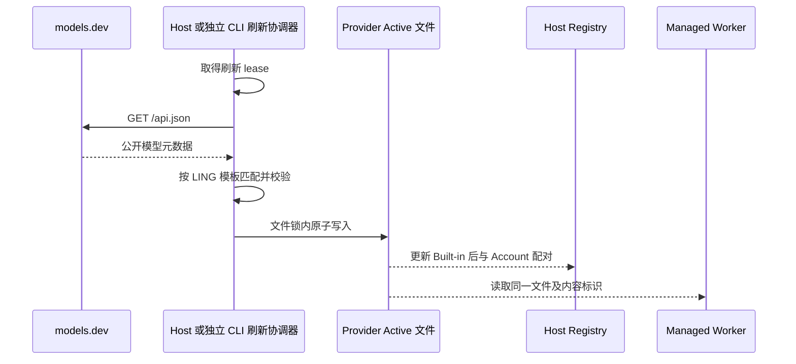

# MR、版本与动态配置交付

本页解释模板/模型配置怎样交付，不授权维护者自动发布。创建 MR、合并、版本发布、修改在线配置指针是不同动作，各自保留结果和责任。

## Git 与 MR

正式配置是唯一编辑源，测试配置和必要文档/测试同一 MR 提交。内容变更使用新的 revision；两份环境文件保持相同 revision，但内容按各自环境派生。合并冲突后重新检查上游最新 revision，不能只解决文本冲突而复用已经被不同内容占用的版本号。

MR 说明至少列出模板与型号增删、默认启停、能力/Map/URL 的具体差异、正式/测试派生结果、官方证据、真实验证及缺口、旧实例/选择影响、交付方式与回退方案。内容按以下五章组织：

| 章节       | 本领域应说明的内容                                                                                     |
| ---------- | ------------------------------------------------------------------------------------------------------ |
| TL;DR      | 具体问题与改变后的行为；真实文件数及增删行数                                                           |
| 目标       | 背景、原有行为、接入或修正的入口/型号、设计意图和验收条件；bugfix 附根因证据、反馈关联与本目录工作记录 |
| 改动范围   | 正式/测试配置、代码、测试、本目录规范与库存的实际变化，以及非目标                                      |
| 验证       | 实际命令及结果，Key/地区/套餐/协议矩阵，未验证项；bugfix 对应回归用例，有交互变化时附证据              |
| 风险与回滚 | 旧实例、个人覆盖、目标客户端版本、上线方式和恢复方案                                                   |

提交标题采用 `<type>(<scope>): <subject>`，例如文档整理使用 `docs(provider)`；内容变更与纯文档区分。文件规模来自 `git diff --shortstat origin/staging...HEAD`，描述契约以仓库 `zcode-mr` skill 为准，不能编造根因、反馈关联或验证结果。

创建/更新 MR 使用仓库 `zcode-mr` 工具：在干净的特性分支先运行 `python3 .agents/skills/zcode-mr/scripts/zcode_git_workflow.py setup` 检查认证，将五章描述写入临时 UTF-8 文件，再运行 `python3 .agents/skills/zcode-mr/scripts/zcode_git_workflow.py mr --description-file <描述文件> staging`。工具会保留 push hook、查找同源/目标 MR 并只在缺少时创建。检查返回的真实 MR URL；仅生成预填链接不算创建成功。已有 MR 的正文变化还需通过 glab 更新并核对。认证失败保留本地成果，不把凭据写入描述或命令。

普通目录改动走配置 MR；新协议、Access、Adapter、Logo 资源或 UI 行为需要对应代码和测试，不能以“只是模型更新”省略检查。缺 Key 的变更在 MR 中清楚保留真实 API 待验证项，默认启用按维护范围原则决定，不把缺 Key 作为额外例外审批事项。

## LING 运行时目录

LING 随包维护供应商模板、可用成员、协议、地址、鉴权和参数映射。Host 与独立 CLI 从 `https://models.dev/api.json` 刷新通用模型目录。模型按 LING 指定的供应商和原始模型 ID 匹配，读取上下文、输出上限、输入模态、工具调用和结构化输出能力。直连 OpenAI、Anthropic 和 xAI 模板可以从各自目录加入支持文本与工具调用、尚未弃用的通用聊天模型。直连 OpenAI 的公开 effort 档位通过随包定义的 Responses 参数传送。套餐、聚合和协议分流模板只更新已列入的模型资料。订阅、固定账号供应商及未选模板的自定义连接由各自的现有配置管理。Personal 配置仍可覆盖通用模型资料。

- public GET 不传凭据，不跟随重定向。下载或校验失败沿用最后一次有效目录，首次无有效缓存则用随包配置。
- 与旧控制面目录分开存放。按环境、平台和产品版本隔离，随包 revision 改变时以新随包内容为基线。相同随包 revision 的目录按内容去重，变化时 Host 与 Worker 使用相同的内容标识发布。
- 启动检查，成功后每小时刷新一次。设置页手动刷新绕过到期时间，继续复用现有 lease、失败退避和原子写入机制。
- Worker 只读目标 Host 的 Active 文件。桌面和手机设置页都读取目标 Host 的模型视图，现有会话传输与队列语义沿用。

验收覆盖启动下载、手动刷新更新设置和执行时的模型资料、失败保留最后一次有效结果、个人覆盖、普通模型与 ChatGPT 订阅隔离，以及独立 CLI 与 Managed Worker 采用同一内容。

桌面候选 BIR-01/02 通过隔离目录将刷新控制记录推进到期，再验证每分钟检查触发自动 GET、设置页手动刷新也请求同一 URL。真实一小时排期与内容幂等由 CLI 回归测试覆盖。
