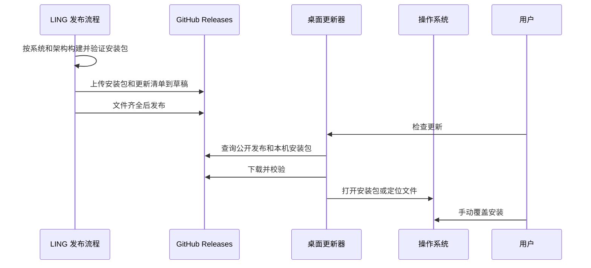

# LING 桌面 GitHub Releases 更新

LING 安装包只从公开的 `aqcool/ling-desktop` GitHub Releases 检查和下载更新。更新请求不携带 ZCode 账号凭据、设备标识或业务后端配置。LING 启动时跳过原版的强制更新服务。未打包的开发端可显式使用本地测试清单。

所有桌面身份均提供「检查更新」。签名更新器可用时沿用原有流程，使用对应架构的更新清单并保留 SHA-512、系统版本和平台签名校验。签名更新器未启用时，手动点击即检查 GitHub Releases 并下载可安装的新版，启动时不下载。

两种流程均由桌面主进程管理，复用菜单状态与结果反馈。手动安装读取已发布的 `ling-vVERSION`，跳过草稿、旧版本及缺少目标安装包的发布。正式版本号即使因手动分发被 GitHub 标为预发布，也参与检查。带预发布后缀的版本由「接收预览更新」设置控制。macOS 下载对应架构的 DMG，Windows 下载 EXE，Linux 按安装格式选择 AppImage 或 DEB。

主进程一次只处理一项手动更新，下载边写入临时文件边计算 SHA-256，只有大小和发布的 `SHA256SUMS` 均匹配才移到下载目录的 `LING Updates`。重复检查可复用校验通过的安装包。macOS 和 Windows 交给系统打开，无法打开时定位到文件，Linux 直接定位安装包。覆盖、安装和首次运行由用户和系统处理。

发布工作流在仓库变量 `LING_SIGNED_RELEASES=1` 时启用更新。macOS 使用仓库配置的 Developer ID Application 签名与 Apple 公证，Windows 使用配置的 Authenticode 签名。两个 macOS 架构分别上传 ZIP 和独立清单。Windows 使用 NSIS。Linux 更新文件涵盖本项目对外发布的 AppImage 和 Deb。更新文件和清单与同次构建的安装包一起校验并上传。启用更新后，正式版本标签发布为稳定版，带预发布后缀的标签发布为预发布版。未配置或未开启签名发布的流水线继续生成手动安装的预发布版。

仓库签名 Secrets 为 `LING_MAC_CSC_LINK`、`LING_MAC_CSC_KEY_PASSWORD`、`LING_MAC_SIGNING_IDENTITY`、`LING_APPLE_ID`、`LING_APPLE_ID_PASSWORD`、`LING_APPLE_TEAM_ID`、`LING_WIN_CSC_LINK` 和 `LING_WIN_CSC_KEY_PASSWORD`。已经装好的旧版需要覆盖安装首个包含「检查更新」下载功能的版本。

标签推送与手动发布都从默认分支检出完整历史，验证远端附注标签对象及其指向的提交。各平台始终打包该标签指向的提交。

未启用签名的 Intel Mac 发布由 CI 直接将已打包的 `LING.app` 和「应用程序」链接制作成 DMG，避免打包过程中写入并弹出已挂载的卷。安装盘使用 Finder 默认布局，继续执行包体检查、`hdiutil verify` 与原生运行验证。

验收覆盖以下场景。

- 同一次构建的目标架构、版本、文件名、格式和 SHA-512 必须与清单一致。Mac arm64 和 x64 清单可同时存在。
- 从桌面菜单检查更新，使用模拟 GitHub 发布列表、校验和及安装包，在系统打开边界断言前一步已经完整保存并校验文件。覆盖普通版本号的手动预发布、有后缀的预览版本、重复点击及校验失败后的重试。
- 下一次签名发布后，用两版相同签名身份的安装包验证从旧版到新版的检查、下载、安装和重启。
