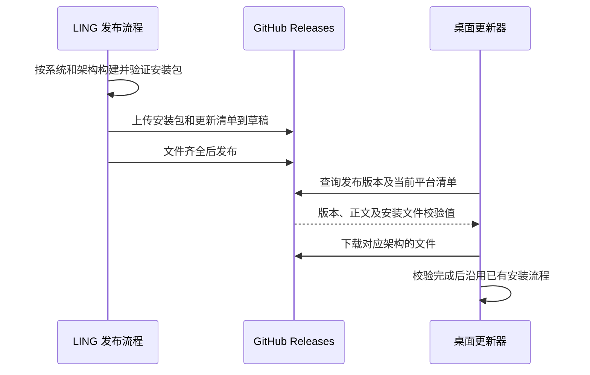

# LING 桌面 GitHub Releases 自动更新

LING 安装包只从公开的 `aqcool/ling-desktop` GitHub Releases 检查和下载更新。更新请求不携带 ZCode 账号凭据、设备标识或业务后端配置。LING 启动时跳过原版的强制更新服务。未打包的开发端可显式使用本地测试清单。

正式安装身份默认接收稳定版。设置里的预览更新开关允许接收有更新清单的 GitHub 预发布版，仍可收到较新的稳定版。仅接收 `ling-vVERSION` 标签中针对本机架构发布的更新清单。草稿、历史手动安装版以及缺少当前安装格式的版本不作为更新目标。缺少发布版时保持当前版本。更新检查、下载、安装及版本偏好继续由桌面主进程管理，下载保留 SHA-512 校验、系统版本限制和平台签名校验。

发布工作流在仓库变量 `LING_SIGNED_RELEASES=1` 时启用更新。macOS 使用仓库配置的 Developer ID Application 签名与 Apple 公证，Windows 使用配置的 Authenticode 签名。两个 macOS 架构分别上传 ZIP 和独立清单。Windows 使用 NSIS。Linux 更新文件涵盖本项目对外发布的 AppImage 和 Deb。更新文件和清单与同次构建的安装包一起校验并上传。启用更新后，正式版本标签发布为稳定版，带预发布后缀的标签发布为预发布版。未配置或未开启签名发布的流水线继续生成手动安装的预发布版。

仓库签名 Secrets 为 `LING_MAC_CSC_LINK`、`LING_MAC_CSC_KEY_PASSWORD`、`LING_MAC_SIGNING_IDENTITY`、`LING_APPLE_ID`、`LING_APPLE_ID_PASSWORD`、`LING_APPLE_TEAM_ID`、`LING_WIN_CSC_LINK` 和 `LING_WIN_CSC_KEY_PASSWORD`。对已安装的旧手动版，先手动安装首个启用自动更新的版本。

验收覆盖以下场景。

- 同一次构建的目标架构、版本、文件名、格式和 SHA-512 必须与清单一致。Mac arm64 和 x64 清单可同时存在。
- 从模拟发布列表检查正常稳定版、预发布开关、手动安装版本和没有发布时的行为。发布列表与清单只解析 LING 名下的文件。
- 下一次签名发布后，用两版相同签名身份的安装包验证从旧版到新版的检查、下载、安装和重启。
