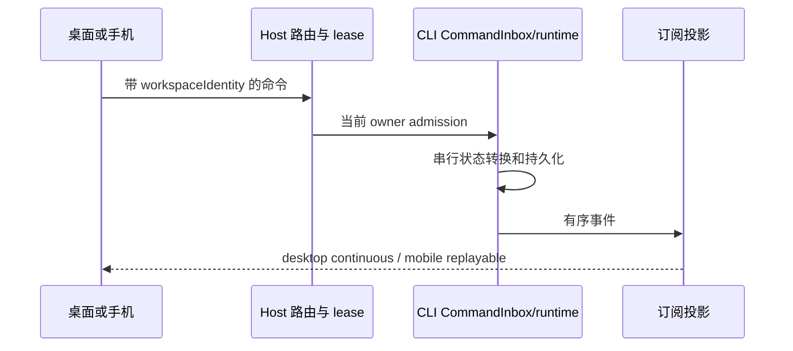

# ZCode 4.0.0 上游整合

## 来源与规则

- 本次固定上游为 `https://github.com/zai-org/ZCode` 的 `a4b4445141eb7d3b3e99eada9292775383bfc44e`（2026-11-23 发布的 4.0.0）。
- LING 从 3.18.2 源码快照独立建库，三方合并基线为上游 `fec975905a2abd4c07e35c40d51fa097a2258ec9`；本地起点为 `5bd2c0bd92`。保留两边历史，用显式源码基线整合后记录上游父提交，供后续增量合并使用。
- 本地和 origin 继续仅使用 master。LING 应用版本保持 0.1.0，保留品牌、图标、GitHub 安装包更新、发布签名及 CI 配置。
- 保留 LING 的 ChatGPT 订阅、模型选择、供应商模板合并、图像生成插件和 iroh 手机远控。引入上游运行时、工具、浏览器、插件发现、认证和 UI 的兼容更新。
- 不恢复 LING 已移除的遥测、反馈、Coding Plan 商业入口、私有站点插件及相关内部依赖。上游改动落在已删除模块时保持删除；新调用点必须遵守同一边界。
- App 业务单测仍退役，不恢复其 test/spec 或 contract.test.ts；保留 CLI/CUA、工程门禁、E2E 和浏览器验收证据。

## 所有者与接口

CLI/runtime 继续独占会话事实与 CommandInbox admission；Host 独占任务组织态、owner/lease 与路由；Main 只负责原生能力、进程及转发。手机复用桌面 attachment，不创建第二套运行时或业务快照。

保持 workspaceIdentity 与 workspacePath 分工、remoteSessionId 关联、stale run 防护和 migration checksum。Provider 模板由现有 registry owner 合并；LING 本地扩展不能被远端模板刷新覆盖。共享平台能力通过 IPlatformService 暴露。

## 验收

模型菜单改用上游 Popover 后，LING 的 Fast 和管理模型按钮使用共享 Button；Fast 以 aria-pressed 表达状态，点击不关闭面板，管理模型先关闭面板再打开设置。两者不得继续依赖 DropdownMenu context。浏览器夹具覆盖桌面/手机、深浅主题和中英文，保留插件面板外部点击隔离与键盘焦点规则。

1. 所有内容冲突和删除冲突逐项核对；Git diff 无冲突标记。
2. Node 24.14.0 下执行 pnpm typecheck、pnpm lint 和架构检查。基线 lint 为 544 warnings / 0 errors；新增 Hooks 诊断逐项复核，不能只凭退出码接受。
3. 对合并适配涉及的 CLI、工程、数据库 schema、更新器、Provider 与手机远控执行当前包实际提供的相关回归；如运行时资源限制导致无法验收，明确记录。
4. 不留下内部模块的新增引用、不覆盖 LING 品牌与发布来源、不恢复 App 业务单测。

## 验证结果

- `pnpm install --frozen-lockfile`、`pnpm typecheck`、`pnpm --filter @zcode/bootstrap... build`、CLI 和 node-repl-host 各自的 typecheck 均通过。
- `pnpm lint`：540 warnings / 0 errors；基线为 544 warnings / 0 errors。根扫描无新增 Hooks 诊断。对本次变更源码另以独立配置扫描根 ignore 范围：基线 182 条、本次 168 条，无新增诊断，未全库清理历史告警。
- `pnpm architecture:check --changed` 无违规；`pnpm test:architecture` 61 项通过。schema 两库兼容，8 项工程合同通过。
- 定向工程回归（4 个 LING 发布/订阅文件和 tsupChunkIsolation）5 文件 33 项通过；CLI 模型回放、MCP、存储、工具执行和 Memory 定向回归 12 文件 234 项通过；SEA 44 项通过；node-repl-host 10 文件 74 项通过。
- 浏览器模型菜单 12 项通过（Electron/手机、深浅主题、中英文，另含 LING Fast 和管理按钮）；崩溃恢复浏览器夹具 12 项通过。第一次菜单验收在入场缩放中取坐标，等待真实动画结束后保持原有焦点和可见性断言通过，不增加产品延时。
- iroh 的隔离运行时用例 `iroh-mobile-pairing.mjs` 通过：一次性二维码鉴权、拒绝陌生 peer、SID 和 Host 重启后可信 peer 重连。
- 工具输入校验 E2E fixture 校验通过；两个结果文本 marker 无 matcher 的提示保留。没有执行全部桌面 E2E、真实模型联调、手机真机和三平台发行安装。
- node-repl-host 的截图排序沿用上游最终 content 索引，删除合并产生的旧重复声明；账本继续只记录可信应用身份和截图，清理三份旧 CLI 测试中针对已退场 browserUse/computerUse 遥测标签的断言，不恢复产品埋点。
- 三方声明按合并后的依赖图重新生成；iroh 1.2.0 npm 包缺少完整许可文件，补入其版本标签 `66a8d619a4d791d458d582f312df6e0ab42bc541` 的原始 LICENSE-MIT，并固定内容哈希。
- `docs:stale-phrases:check` 通过；远程目标检查因公开仓库没有私有队列而跳过。合并提交后 `pnpm verify:pre-push` 通过。affected push 选择了 184/184 个工程规格，按仓库既有规则跳过全量（未执行），不把它计为测试通过；定向 33 项工程结果独立记录。提交后门禁发现并移除了仅指向退场遥测单测的 shared/vitest.config.ts。
