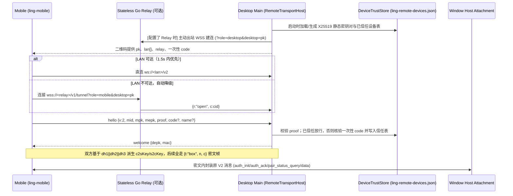

# LING 移动端远程连接 v2（E2EE 多路径传输与无状态 Go Relay）

## 1. 背景与目标

替换 `@number0/iroh`（Desktop）与 `modules/ling-iroh`（Mobile Rust 原生模块），参考 DSH-GO 生态的分级路径协商与端到端加密思路：

- **零原生传输依赖**：Desktop 仅使用 Node 内置 `node:crypto` + `ws`；Mobile（Expo / React Native）仅使用标准 `WebSocket` + 纯 TypeScript RFC 7748/8439/5869 加密模块，Android / iOS / macOS (arm64 & x64) / Windows (x64 & arm64) / Linux 全平台一致。
- **分级选路**：Mobile 按 `LAN 直连（1.5s 并发探测）→ 公网无状态 Relay（兜底）` 自动建连；无论走哪条链路，应用层均跑统一的 **X25519 + HKDF-SHA256 + ChaCha20-Poly1305** 端到端加密通道。
- **状态归属清晰**：
  - Desktop Main 进程只拥有：独立设备信任库（`ling-remote-devices.json`，与 `ServiceChannels.Credential` 彻底隔离）、一次性配对码、E2EE 会话密钥与帧转发；不持有 task/session 业务状态。
  - Window Host Attachment 保持原有 `web-remote-replayable` 语义、snapshot/gap 恢复与终端隔离边界不变。
  - 公网 Relay（`services/ling-relay`）完全无状态，只做连接复用与密文盲转发。

## 2. 二维码与配对链接格式（v2）

```text
ling-mobile://connect/v2?mid=<desktopMid>&pk=<desktopX25519PubHex64>&name=<deviceName>[&lan=<ipv4:port>][&relay=<wssUrl>]#<oneTimeInviteCode>
```

- `mid`：桌面设备 ID（`<= 128` 字符）。
- `pk`：桌面端持久化 X25519 公钥（64 位小写 hex）。
- `lan`（可重复，最多 8 个）：本机私网 IPv4 监听地址（`ip:port`）。
- `relay`（可选）：公网 Relay WebSocket 入口（`wss://...`，本地调试允许 `ws://127.0.0.1:...`）。
- `#<oneTimeInviteCode>`：32 字节 Base64URL 一次性配对码，有效期 5 分钟，首次配对成功后立即作废；手机端保存设备记录前必须清除 `#fragment`。

## 3. 时序与状态所有权



## 4. E2EE 握手与密文帧协议

1. **密钥协商（1-RTT 双向认证 + 前向安全）**：
   - `dh1 = X25519(mStaticPriv, dStaticPub)`（双向静态身份绑定）
   - `dh2 = X25519(mEphPriv, dStaticPub)`（客户端新鲜度）
   - `helloKey = HKDF-SHA256(ikm = dh1 || dh2, salt = SHA256(dpk || mpk || mepk), info = "ling-e2ee-v2-hello", len = 32)`
   - `proof = HMAC-SHA256(helloKey, "hello:" || mid || ":" || (code ?? ""))`
   - 桌面端验证 `proof` 与信任/邀请码后生成临时密钥对 `(dEphPriv, dEphPub)`，计算 `dh3 = X25519(dEphPriv, mEphPub)`；
   - 派生会话密钥：`okm = HKDF-SHA256(ikm = dh1 || dh2 || dh3, salt = SHA256(dpk || mpk || mepk || depk), info = "ling-e2ee-v2-session", len = 64)`，前 32 字节为 `c2sKey`，后 32 字节为 `s2cKey`；
   - `mac = HMAC-SHA256(s2cKey, "welcome:" || depk || ":" || mepk)`，随 `welcome` 返回，手机端验证后确认桌面身份与前向安全密钥。
2. **密文帧（ChaCha20-Poly1305）**：
   - 帧格式：`{ t: "box", n: <uint32 递增序号>, c: <base64(ciphertext || tag16)> }`
   - 12 字节 nonce：`[0, 0, 0, 0, seq_be64]`，严格校验接收序号 `n === expectedRxSeq`（防重放、防乱序），单帧明文上限 1 MiB。

## 5. 无状态 Relay 复用协议（`services/ling-relay`）

- 路由：`GET /v1/tunnel?role=desktop|mobile&desktop=<64hex>`，`GET /healthz`。
- 手机端收发与 LAN 直连完全相同的文本帧（`hello` / `welcome` / `box` / `err`）。
- 桌面端单条出站 WS 复用多路手机连接：
  - Relay → Desktop：`{ r: "open", c }`, `{ r: "msg", c, d }`, `{ r: "close", c }`
  - Desktop → Relay：`{ r: "msg", c, d }`, `{ r: "close", c }`
- 单连接最大负载 2 MiB，桌面离线时立即向手机返回 `{ t: "err", code: "DEVICE_OFFLINE" }` 并关闭。

## 6. 验收场景

1. **加密互操作**：Node `node:crypto` 与纯 TS（Mobile Hermes 路径）完成完整握手、双向加解密、防篡改与防重放单测全部通过。
2. **独立信任库与吊销**：桌面私钥与已配对手机列表仅存 `ling-remote-devices.json`，不写入 `CredentialService`；`revokePeer` 立即断开该设备连接且后续无邀请码重连被拒。
3. **Go Relay 集成**：`go test ./...` 验证多手机并发复用同一桌面出站连接、桌面离线返回 `DEVICE_OFFLINE`、密文透传与连接清理。
4. **双端静态门禁**：`ling-desktop` 的 `tsc`、`oxlint`、`architecture:check --changed` 与 `ling-mobile` 的 `tsc --noEmit` 全部通过。
